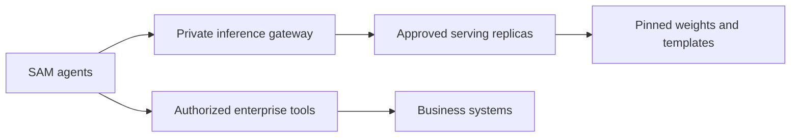

# SAM Open-Weights Model Compatibility

**Enterprise self-hosting edition · 15 October 2026**

Choose, serve and qualify downloadable models for **Solace Agent Mesh (SAM)**. This reference combines a source-linked model catalog with the engineering decisions a large company needs: licenses, data boundaries, GPU capacity, tool security, service reliability and upgrade evidence.

> **Evidence boundary:** 25 downloadable candidates are documented from publisher sources. **None has a live SAM validation result in this repository.** A model card, a leaderboard score or a working chat response does not prove that your model + quantization + template + serving engine + gateway + SAM version can execute tools correctly.

## Start here

| Your decision | Guide |
|---|---|
| Which models should we evaluate? | [Selection guide](docs/pick-a-model.md) · [October catalog](docs/shortlist.md) · [25 model cards](models/cards/) |
| Can we use these weights commercially? | [License and procurement review](docs/licensing.md) |
| How should a large company host this? | [Enterprise architecture](docs/enterprise-self-hosting.md) |
| What GPU capacity and cost do we need? | [Capacity planning and TCO](docs/capacity-planning.md) |
| Which server, parser and SAM settings? | [Serving recipes](docs/serving.md) · [Compatibility requirements](docs/requirements.md) |
| How do we prove it works? | [Validation](docs/validation.md) · [Evaluation and benchmarks](docs/benchmarks.md) |
| How do we operate and upgrade it? | [Operations and rollout](docs/operations.md) |
| What sources and versions were checked? | [Research ledger](docs/sources.md) · [Methodology](docs/methodology.md) |

## October 2026: what changed

The catalog now covers **Qwen 3.8 / 3.6 / 3.5, Gemma 4, Mistral Small 4 / Medium 3.5 / Large 3 / Ministral 3 / Devstral Small 2, DeepSeek V4.1 Flash / V4 Pro 0813, GLM 5.3 / Flash, Kimi K3 / K2.7 Code, NVIDIA Nemotron 3.5 Lightning / Super VL and Nemotron 3 Super / Ultra**, and retained **gpt-oss 20b / 120b** baselines. Each row links to the checked publisher revision and license declaration/text.

**Mistral Large 4 is an API preview at this cutoff; its announced weight release is later in October.** It belongs on the watchlist, not in a downloadable production shortlist. [Publisher announcement](https://mistral.ai/news/mistral-large-4/).

The original catalog is retained as [historical data](models/legacy-2025.csv). Its mixed BFCL versions and qualitative grades no longer determine current recommendations. The previous blanket exclusion of Google models also does not apply to Gemma 4, whose publisher documents native function calling. [Gemma 4 card](https://huggingface.co/google/gemma-4-31B-it).

## The integration contract



Go SAM uses **Bifrost**; Python SAM uses **LiteLLM**. An `openai/` model prefix selects the OpenAI-compatible protocol and `api_base` selects your endpoint. These are different runtime paths, not a universal serial Bifrost → LiteLLM chain. [Source evidence](docs/methodology.md).

The required behavior is native `tool_calls`, correct call IDs and arguments, and continuation using tool results. Streaming tool-call deltas are additionally required for a deployment that enables LLM streaming. Named/required tool choice and parallel calls must be tested when your agents use them. Protocol compatibility is the first gate; production readiness also requires workload, security and operational qualification.

## Run an endpoint smoke test

From the repository root, using an already running endpoint:

```bash
export SAM_TEST_MODEL='openai/Qwen/Qwen3.6-35B-A3B'
export SAM_TEST_API_BASE='http://127.0.0.1:8000/v1'
# Set SAM_TEST_API_KEY from your secret manager if the endpoint requires it.
./scripts/probe.sh --report probe-result.json
```

The probe needs Python 3.10+ and its standard library. It checks native calls, indexed SSE reconstruction and a tool-result continuation with a random receipt. Credentials and response bodies are excluded from the report. A pass qualifies only this smoke test; continue with [real SAM traces](docs/validation.md).

## Maintain the reference

`models/index.csv` is the source for generated cards and the shortlist. It records checkpoint revision, source date, license, candidate role, parser hint and an explicit `not-run` SAM status. Unknown values stay unknown.

```bash
python3 scripts/gen-model-cards.py
python3 scripts/check-catalog.py
python3 -m unittest discover -s tests -p 'test_*.py'
```

See [CONTRIBUTING.md](CONTRIBUTING.md) for evidence requirements. This is an engineering reference, not an official Solace support matrix or a certified deployment bundle.
