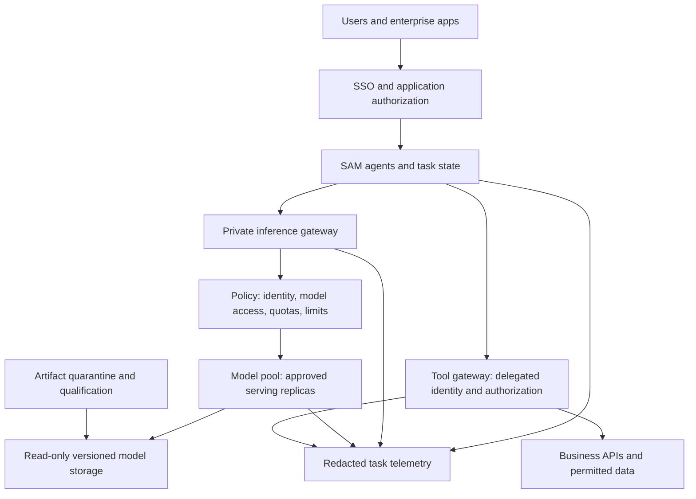

# Enterprise self-hosting architecture

This is a recommended design pattern, not an applied Kubernetes deployment. Adapt the controls to your identity, network and risk model. Ownership must cover the model service, the SAM application and each business tool.

## Reference architecture

The inference service generates decisions; the tool boundary authorizes actions. Keep those responsibilities distinct even when both use the same gateway product.

## Data and identity boundaries

| Boundary | Recommended control | Acceptance evidence |
|---|---|---|
| User → SAM | Enterprise SSO, role and resource authorization, session isolation | Two users with different permissions receive different authorized access |
| SAM → inference | Private route, authenticated workload identity or rotated credentials, TLS | Anonymous and wrong-tenant requests rejected |
| Inference → workers | Dedicated trusted network for distributed runtime traffic | Worker and rendezvous ports unreachable from tenant/application networks |
| SAM → tools | Per-tool authorization, delegated identity where supported, constrained service identity otherwise | Model cannot gain permissions by changing an argument or prompt |
| Retrieval → source data | Enforce source ACLs before retrieval; carry provenance into answers | Cross-user and stale-permission retrieval tests |
| Logs / traces / caches | Minimize payloads, retention limits, restricted access, tenant separation | Sensitive content absent from default telemetry; deletion procedure tested |
| Runtime → outside network | Default-deny egress with approved exceptions | Offline path functions; denied media URLs and tool destinations fail safely |

vLLM's security documentation warns that distributed traffic assumes a trusted network and API-key protection does not cover every endpoint. Put an allowlisted inference surface behind the gateway; isolate metrics, administration and worker traffic. [vLLM security guidance](https://docs.vllm.ai/en/latest/usage/security/).

## Tenant isolation

Use separate model pools for different trust domains or sensitivity classes when shared-process isolation is insufficient. A Kubernetes namespace, quota, GPU partition or cache salt is one layer, not a complete tenant security boundary. Set namespace RBAC, default-deny policies, resource quotas and pod-security controls; verify the CNI enforces policies. Stronger isolation may require dedicated nodes or clusters. [Kubernetes multi-tenancy](https://kubernetes.io/docs/concepts/security/multi-tenancy/).

Treat prefix caches, KV offload, multimodal caches and traces as potential stores of tenant data. Disable cross-tenant reuse unless the serving stack provides a reviewed isolation mechanism. If cache salting is used, derive it from authenticated tenant context in the trusted gateway; do not let a caller select another tenant's salt.

## Model supply chain and air gap

1. Fetch weights, tokenizer, templates, configuration, licenses and optional custom code into quarantine using a controlled acquisition identity.
2. Pin upstream revisions and calculate file hashes. Inspect serialization formats, custom Python/plugins and native kernels; prefer supported safetensors paths. `trust_remote_code` is an execution decision, not a routine compatibility switch.
3. Build and scan the full runtime bundle: image digest, drivers, CUDA/ROCm, framework, dependencies, parser plugins and model files. Retain notices and an SBOM where available.
4. Import through the approved artifact process into internal registries and immutable storage. Mount model files read-only. Remove acquisition credentials from serving workloads.
5. Test startup and inference without internet or a populated external cache. Mirror tokenizers, kernels, auxiliary models and required packages; check DNS, telemetry, crash reporting, update checks and support access.
6. Qualify a complete bundle and sign the promotion record. Retain the previous bundle in the same offline environment.

Do not assume that running weights on premises keeps every byte local: tools, retrieved media, hosted safety services and operational telemetry have their own data paths.

## Agent and tool security

- Treat user text, retrieved documents, tool outputs and image content as untrusted instructions. Test prompt injection against each business action.
- Enforce argument schemas and resource authorization in tool code. Do not accept arbitrary URLs, file paths, SQL, shell commands or account IDs solely because a model returned valid JSON.
- Give tools the smallest permissions and network reach they need. Separate read-only assistance from write-capable agents; record approvals for sensitive actions in the application workflow.
- Use idempotency keys for writes, bounded timeouts, task cancellation and transaction-aware retries. Replaying a model call must not repeat a payment or provisioning action.
- Run generated code and documents in constrained sandboxes. Keep inference processes away from tool credentials and unrestricted execution services.
- For vision and document ingestion, constrain URL destinations, redirects, upload size, decoded size, frame/page counts and processing time. Test SSRF and decompression/resource exhaustion paths.

## Platform ownership

| Owner | Accountable for |
|---|---|
| Application / business owner | Task acceptance, authorized tools, escalation and human review |
| Model platform | Artifact qualification, serving capacity, model aliases, runtime upgrades |
| Security / identity | Tenant boundaries, identities, incident response and policy tests |
| Data owner | Retrieval permissions, retention, residency and allowed processing |
| Procurement / legal | Exact license, redistribution, derivatives, support and contractual obligations |
| SRE / FinOps | SLOs, on-call, restore drills, cost allocation and capacity commitments |

An internal service catalog should publish owner, approved use, model alias and bundle digest, tested context/concurrency limits, data classification, supported features, SLO, support route and retirement date.
